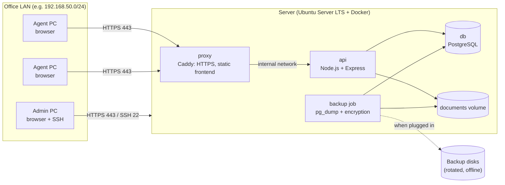

# Architecture

Phase 2 design, approved by the owner (PR #3). Updated in Phase 3 with the foundation choices.
Related: [security.md](security.md) (threat model), [network.md](network.md) (LAN and firewall),
[data-model.md](data-model.md) (entities and status machines), [insurer-rules.md](insurer-rules.md).

## 1. Overview

One server on the office LAN runs everything in Docker. Agent PCs only need a browser.



| Component | Role | Exposed to LAN? |
|---|---|---|
| `proxy` (Caddy 2) | Terminates HTTPS with a local certificate authority, serves the built React app, forwards `/api` to `api`, sets security headers | **Yes**, port 443 only, bound to the server's LAN address |
| `api` (Node.js 24 LTS, Express) | All business logic, authentication, authorisation, validation, audit, file access, PDF generation | No (internal Docker network) |
| `db` (PostgreSQL 18) | Single source of truth | No (internal network, no published port) |
| `documents` volume | Uploaded files, outside any web root | No (only `api` mounts it) |
| `backup` job | Scheduled encrypted dumps of the database and documents | No |
| `clamav` (optional) | Local malware scan of uploads | No, decided in Phase 8 |

Why Caddy rather than Nginx: Caddy has a built-in local certificate authority (`tls internal`), so HTTPS works
offline without hand-made certificates. The only manual step is installing its root certificate once on each agent PC
([network.md](network.md) §5). No Redis, queue or cloud service is needed for one agency of a few users.

## 2. Backend structure

```text
backend/
├── prisma/                 schema.prisma, migrations/, seed.js (demo data only)
├── src/
│   ├── app.js              Express app: middleware order, routes, error handler
│   ├── server.js           starts HTTP server, graceful shutdown
│   ├── config/             env loading + validation (fails at startup if invalid)
│   ├── middleware/         session, csrf, authorise(permission), rateLimit, requestId, errorHandler
│   ├── modules/
│   │   ├── auth/           routes.js, controller.js, service.js, schemas.js
│   │   ├── users/
│   │   ├── customers/
│   │   ├── vehicles/       (and fleets)
│   │   ├── catalogue/      (insurers, attestation models, vehicle usages, attestation series, products, rules register)
│   │   ├── contracts/      (contracts, covered vehicles, status history, attestations; later amendments, renewals)
│   │   ├── stock/          (blank attestation batches, forms, movements)
│   │   ├── renewals/       (renewals of issued contracts, home dashboard summary)
│   │   ├── payments/       (payments at the agency, receipts, reversals)
│   │   ├── remittances/    (premiums paid over to the insurers, bordereaux, rule L5)
│   │   ├── documents/      (scans of the insurers' documents attached to contracts)
│   │   ├── reports/        (the agency's reports and their CSV / Excel exports)
│   │   ├── today/          (home page: one search, the to-do list)
│   │   ├── scans/          (scanned attestations: offline reading, review, filing)
│   │   ├── claims/
│   │   ├── documents/
│   │   ├── reports/
│   │   ├── audit/
│   │   └── settings/
│   ├── services/           shared: prisma client, logger, audit writer, file storage, pdf, clock, numbering
│   ├── generated/prisma/   Prisma client, generated by `npm run build` (git-ignored)
│   └── utils/
└── test/                   unit/, integration/ (real PostgreSQL)
```

Prisma 7 note: the recommended `prisma-client` generator writes TypeScript files. Our code stays JavaScript and
imports `generated/prisma/client.ts`; Node 24 runs those generated files directly (built-in type stripping), with no
build step. The older JavaScript generator (`prisma-client-js`) is deprecated, so it was not chosen. Prisma talks to
PostgreSQL through the `@prisma/adapter-pg` driver adapter.

Rules for every module:

- **Route** declares path + permission + schema. **Controller** turns HTTP into a service call. **Service** holds business
  rules and transactions. Only services touch Prisma.
- Every input goes through a Zod schema with `.strict()` (unknown fields rejected, which blocks mass assignment).
- Every protected route calls `authorise('permission.name')`, then the service checks access to the **specific record**.
- Any state change that matters writes an audit event **in the same database transaction**.
- Status changes go through one function per entity that checks the allowed transition table ([data-model.md](data-model.md) §3).

## 3. Frontend structure

```text
frontend/src/
├── main.jsx, App.jsx       router, providers
├── layouts/                AppLayout (sidebar, header), AuthLayout
├── pages/                  one folder per route (Customers/List.jsx, Customers/Detail.jsx …)
├── features/               feature components and hooks (customers/, contracts/ …)
├── components/             shared UI: Button, Input, Select, Table, Pagination, Modal, ConfirmDialog,
│                           EmptyState, ErrorState, Spinner, StatusBadge, Money, DateText
├── services/api.js         fetch wrapper: credentials, CSRF header, error mapping
├── hooks/                  useAuth, usePermission, useUnsavedChanges …
├── i18n/fr.js              all interface text (French first)
└── utils/                  format MAD amounts, dates in Africa/Casablanca
```

- Tailwind CSS and Heroicons are bundled by Vite. Fonts are self-hosted files in the build. No CDN.
- Hidden buttons are convenience only. The API enforces every permission.
- Errors shown to users are generic French messages plus a request id. No stack traces or raw server text.

## 4. Key flows

### 4.1 Login and requests

1. `POST /api/auth/login` with username and password. Rate-limited, progressive delay on failures.
2. On success: a new random session token (32 bytes), stored in the database **as a SHA-256 hash**, sent as cookie
   `__Host-session` (`HttpOnly`, `Secure`, `SameSite=Strict`, `Path=/`). The response gives the session **stage** and
   a CSRF token (a hash derived from the session token, held in memory by the browser app, never in storage).
3. The stage says what the user must do before using the app, in this order: `TOTP_VERIFY` (enrolled second factor)
   → `PASSWORD_CHANGE` (temporary password) → `TOTP_ENROLL` (administrator or manager without a factor) → `ACTIVE`.
   Each step has its own endpoint and **rotates the token**. Permissions are only granted to `ACTIVE` sessions.
4. Each request: the session is looked up by hash, idle and absolute expiry are checked, the user must still be active,
   and permissions are loaded from the role **on every request** (role changes apply immediately).
5. Every non-GET request needs header `X-CSRF-Token` matching the session, and an `Origin` matching the configured app URL.
6. `GET /api/auth/me` tells the app who is signed in (`{ authenticated: false }` when nobody is: a normal answer, not an
   error). Any other protected endpoint answers 401 without a session, and the app then shows the login page.

| Endpoint | Allowed stage | Purpose |
|---|---|---|
| `POST /api/auth/login` | none | Password check, creates the session |
| `GET /api/auth/me` | any or none | Current user, stage, permissions, CSRF token |
| `POST /api/auth/totp/verify` | `TOTP_VERIFY` | Second-factor code |
| `POST /api/auth/password` | `PASSWORD_CHANGE`, `ACTIVE` | Change own password (ends other sessions) |
| `POST /api/auth/totp/enroll/start`, `/confirm` | `TOTP_ENROLL`, `ACTIVE` | Enrol an authenticator app |
| `POST /api/auth/reauth` | `ACTIVE` | Confirm identity for 5 minutes before sensitive actions |
| `POST /api/auth/logout` | any | End the session |
| `GET /api/system/status` | `ACTIVE` + `system.health` | Signed-in readiness view |
| `GET /api/health`, `/api/ready` | public | Docker health checks (up/down only) |
| `GET /api/agency/brand`, `/api/agency/logo`, `/api/agency/icon` | public | The installation's agency before sign-in: name, tagline and whether a logo and icon are set; the images as checked at startup (PNG or JPEG by their first bytes, 1 MB at most, `AGENCY_LOGO_FILE` / `AGENCY_ICON_FILE`), cached one hour. No identifier (ICE, agrément…) is public: those stay on the receipt, behind sign-in. 404 when not set |
| `GET /api/roles`, `GET /api/users`, `GET /api/users/:id` | `users.read` | Roles, user list (search, status, pages), one account |
| `POST /api/users`, `PATCH /api/users/:id`, `POST /api/users/:id/{disable,enable,reset-password,reset-two-factor,unlock,end-sessions}` | `users.manage` + re-authentication within 5 min | Account administration; every change carries the `version` read (409 on conflict) and is audited in the same transaction |
| `GET /api/customers` (search, type, archived, pages), `GET /api/customers/:id` | `customers.read` | List rows carry no identity number; the detail masks it unless `customers.identity` or the user is the responsible agent |
| `POST /api/customers`, `PATCH /api/customers/:id` | `customers.write` | Duplicate checks; only `customers.assign` may choose the responsible agent; nobody may change an identity number they cannot see |
| `POST /api/customers/:id/archive`, `/restore` | `customers.archive` | Archive with a reason; archived customers cannot be edited |
| `POST /api/customers/:id/reveal-identity` | `customers.reveal` | Shows a masked number after a written reason, audited |
| `GET /api/customers/assignees` | `customers.assign` | Active staff names for the "responsible agent" list |
| `GET /api/vehicles` (search by plate in any spelling, make, owner; category, customer, fleet, archived), `GET /api/vehicles/:id` | `vehicles.read` | |
| `POST /api/vehicles`, `PATCH /api/vehicles/:id` | `vehicles.write` | Same plate or chassis number refused; category rules; fleet must belong to the owner; owner not editable |
| `POST /api/vehicles/:id/archive`, `/restore` | `vehicles.archive` | With a reason; restore re-checks the plate |
| `GET /api/fleets?customerId=`, `POST /api/fleets`, `PATCH /api/fleets/:id` | `vehicles.read` / `vehicles.write` | Fleets of a customer with active vehicle counts |
| `GET /api/insurers`, `/api/attestation-models`, `/api/vehicle-usages`, `/api/insurer-usages` (read only: the RMA GAMA list under the legal usages), `/api/attestation-series`, `/api/products` (insurer, line, status, active, text), `/api/products/:id` | `catalogue.read` | Every role. Each entry shows its source and, once confirmed, who confirmed it, when and from which document |
| `POST`/`PATCH` on the same paths | `catalogue.manage` | Administrator and manager. A third active insurer is refused (`INSURER_LIMIT`, rule L1) unless `confirmLimit` is sent; the override is audited. Editing what was confirmed (model or usage label, a usage's model, series code, product name/line/code/description) makes the entry "à confirmer" again. A model's letter and provisional kind never change (trigger); a series' model is chosen (`modelCode`; on creation the code's letter by default) among active models (`UNKNOWN_MODEL`, `MODEL_INACTIVE`), and changing it asks for a new confirmation; a usage never takes the provisional model (`MODEL_PROVISIONAL`). No delete: entries are deactivated |
| `POST /api/{attestation-models,vehicle-usages,attestation-series,products}/:id/confirm` | `catalogue.manage` | Needs the reference of the confirming document. A usage needs its model set and confirmed first, and so does a series (`MODEL_NOT_CONFIRMED`) |
| `GET /api/rules` (insurer or `GENERAL`, status, text without accents), `GET /api/rules/:id` (with review history) | `catalogue.read` | Register order L…, R…, C… |
| `POST /api/rules`, `PATCH /api/rules/:id`, `POST /api/rules/:id/review` | `catalogue.manage` | A new rule cannot start `CONFIRMED`; a review to `CONFIRMED` needs a document reference; a confirmed rule's text is locked until a review changes its status |

| `GET /api/contracts` (reference, policy number or customer; status, customer, insurer), `GET /api/contracts/:id` (vehicles, attestations, status history) | `contracts.read` | Every role. `period` (À venir / Actif / Expiré) is calculated from the dates for an issued contract, never stored |
| `POST /api/contracts`, `PATCH /api/contracts/:id`, `POST /api/contracts/:id/vehicles`, `…/vehicles/:vehicleId/remove` | `contracts.write` | Gapless reference `CTR-YYYY-NNNNN`; confirmed, active product only (`PRODUCT_NOT_USABLE`); vehicles of the customer, not archived; only a draft is edited (`NOT_EDITABLE`); a removed vehicle keeps its row |
| `POST /api/contracts/:id/transition` | `contracts.write`, plus `contracts.terminate` to suspend, reinstate or terminate an issued contract (refusal audited) | Status machine of data-model §3.2 (`INVALID_TRANSITION` otherwise). Issue needs the insurer's policy number (unique per insurer) and proof; insurer decisions need the insurer's reference and date; every cancellation needs a reason. Each change is written to the append-only history |
| `POST /api/contracts/:id/attestations`, `POST /api/attestations/:id/cancel` | `contracts.write` | Confirmed series of the contract's insurer; definitive only after issue, of the model of the vehicle's usage (`MODEL_MISMATCH`, L16) and inside the contract period; provisional one month at most, exactly one month allowed like the platform prints it (L23); serial number unique per series, except a duplicate that repeats it (L26); cancellation with a reason | A paper attestation uses its form from the stock (below) |
| `POST /api/contracts/:id/amendments`, `POST /api/attestations/:id/returned` | `contracts.write` | Avenant on an issued contract (L28; owner, 28/10/2026), one transaction: effective date inside the contract, avenant number once per contract (`DUPLICATE_AMENDMENT`); vehicle change: the replaced vehicle (`previousVehicleId`, none when it was never recorded) leaves the contract and is archived unless another running contract covers it ("Remplacé par avenant n° … sur CTR-…", audited), the new one (the customer's, not archived) joins; registration change: the vehicle takes its new plate (unique, not the same, audited with both plates); then the new attestation, checked like any other (shared `insertAttestation`), and the vehicle's running attestations marked replaced; the avenant's amount added to `amendmentsTotal`, so what is owed (contract list, payments, "doit encore", the to-do list) is the premium plus the avenants. "Papier rendu" records the replaced paper back at the agency, once | `GET /api/vehicles/:id` lists the avenants that renumbered or replaced the vehicle; the home search finds a vehicle by a plate it had before a registration change |
| `GET /api/attestation-stock/summary`, `GET /api/attestation-batches`, `GET /api/attestation-forms` (series, status, holder, number), `GET /api/attestation-forms/:id` (movements) | `stock.read` | Every role |
| `POST /api/attestation-batches`, `POST /api/attestation-forms/move`, `GET /api/attestation-stock/holders` | `stock.manage` | Administrator and manager. A batch is a range of serial numbers of a confirmed series (at most 5 000, leading zeros kept, no overlap with the stock: `FORMS_ALREADY_IN_STOCK`). A movement changes a whole range: assign to an employee, back to stock, damaged / lost / returned to the insurer with a reason; every form must be in an allowed status (`FORM_STATUS_CONFLICT`, with sample numbers) |

| `GET /api/renewals` (open / renewed / not renewed, mine), `GET /api/renewals/summary` (home dashboard), `GET /api/renewals/:id` (history) | `renewals.read` | Every role. Before each read, a renewal is opened for every issued contract ending within 30 days that has none and no following contract (no background job). `daysLeft` and the notice deadline (L11) are calculated. The list and the summary carry the customer's phone (to call) only for a caller who also holds `customers.read` |
| `PATCH /api/renewals/:id` (step, note, "not renewed" with a reason), `POST /api/renewals/:id/renew` | `renewals.write` | A closed renewal does not change (`RENEWAL_CLOSED`). "Renouveler" creates the next contract as a draft through the same code as "Nouveau contrat" (same customer, product, vehicles, terms; dates following on), linked by `previousContractId` |
| `POST /api/renewals/:id/assign`, `GET /api/renewals/assignees` | `renewals.assign` | Administrator and manager |

| `GET /api/contracts/:id/payments` (premium, paid, balance), `GET /api/payments` (period in agency days, method, employee; totals per method, and `roundingGap` / `roundings`: the agency's cash roundings of payments not reversed), `GET /api/payments/:id` (receipt), `GET /api/agency` | `payments.read` | Every role. The receipt carries the agency's settings (`modules/agency/details.js`): logo, name, tagline, then at its foot the legal line as on the letterhead (address, phones, e-mail, legal form and capital, Patente, I.F, ICE, R.C, CNSS, agrément); never an insurer's logo (rules L2, L3; owner, 30/10/2026) |
| `POST /api/contracts/:id/payments` | `payments.record` | Needs the insurer premium on the contract (`PREMIUM_REQUIRED`); never more than what is left (`AMOUNT_ABOVE_BALANCE`, L4), checked with the contract row locked so simultaneous payments add up; cheque, transfer and "other" need their reference; optional `clientPaid`, the cash the customer really gave when the agency rounded (owner, 29/10/2026: 751,55 paid with 752,00, 750,66 with 750,00): cash only (`ROUNDING_CASH_ONLY`), different from the amount (`ROUNDING_SAME_AMOUNT`), for the whole balance only (`ROUNDING_WHOLE_BALANCE`); the amount stays the exact premium owed to the insurer (L4), the gap (`roundingGap`) is the agency's, shown in the payment history and never printed on the receipt; optional `cashTendered`, the cash handed over (owner, 30/10/2026: « Somme reçue / Rendu » as on the agency's former receipt): cash only (`CHANGE_CASH_ONLY`), never less than what the customer pays, the rounded sum when rounding (`CHANGE_BELOW_PAID`; a CHECK too); the payment and receipt return it with `change`, printed on the amount's line of the receipt; gapless receipt number per year; the browser's `idempotencyKey` makes a repeated request record one payment |
| `GET /api/remittances/summary` (per insurer and month of collection: amount, count, due date, days left, late), `GET /api/remittances/outstanding` (what a remittance up to a day would include), `GET /api/remittances` (insurer, status), `GET /api/remittances/:id` (bordereau) | `remittances.read` | Administrator, manager, auditor |
| `POST /api/remittances` | `remittances.manage` | Administrator and manager. Includes the payments and reversals of the insurer received up to `collectedUntil` and in no active remittance; a payment and its reversal both still to remit cancel out; refused when nothing is owed (`NOTHING_TO_REMIT`) or when the total differs from the one the user saw (`AMOUNT_CHANGED`); the insurer row is locked so two remittances never take the same payment (and a partial unique index refuses it anyway); dates not in the future; reference required except for cash; gapless number per year; `idempotencyKey` |
| `POST /api/remittances/:id/cancel` | `remittances.manage` | With a reason; the remittance stays, marked cancelled, and its payments are to remit again. Remittances are never edited or deleted (privileges and triggers) |
| `GET /api/reports`, `GET /api/reports/:name?from&to` (period of one year at most; `reversements-dus` and `soldes-clients` are today's state: `soldes-clients` lists issued contracts whose customer still owes part of the premium, oldest start first, with phone, balance, last payment, days since the start and « Plus de 15 jours » past `LONG_UNPAID_DAYS`; the « Aujourd'hui » unpaid line also counts those; `ecarts-caisse` lists the cash roundings of the period, payments not reversed: owed to the insurer, given by the customer, the agency's gap and who accepted it, with totals; every time a period filters on (payments, contracts, status changes, attestations, stock movements, renewal follow-up, documents) is stamped by the app's clock, never by the database's own `now()`) | `reports.read` | Administrator, manager, auditor |
| `GET /api/reports/:name/export?from&to&format=csv\|xlsx` | `reports.export` + re-authentication in the last 5 minutes | Administrator and manager; audited `report.exported` (period, format, number of rows). CSV: UTF-8 with BOM, `;`, decimal comma, DD/MM/YYYY. Excel: one sheet written by `services/spreadsheet.js` (no library), amounts as numbers. Cells starting with `= + - @` are prefixed with `'` (formula injection) |
| `POST /api/scans` (file as body, like documents), `GET /api/scans?status`, `GET /api/scans/:id`, `GET /api/scans/:id/file`, `GET /api/scans/:id/matches?identityNumber&registration&policyNumber&seriesId&number`, `GET /api/scans/:id/products?seriesId`, `POST /api/scans/:id/file`, `POST /api/scans/:id/discard` | `scans.manage` | Administrator, manager, agent. A PDF with text is read first with `services/pdfText.js` (pdf.js 6.4.299, legacy build: no eval, no fonts, no network; lines rebuilt per half of the page, letter-spaced fields and the narrow capital I rejoined; a value printed on both halves, the holder's name and the make, keeps only the spaces both halves show, so "KIL I" becomes "KILI"; the platform's document reference printed above the name is skipped; letter-spaced guarantee names, a thousands dot "1.277.00" and the payment line without its accented letters are read); when it is an RMA platform sheet (`scans/platform.js`: an attestation number "14D 203389169" and a 15-digit policy), every value is exact (confidence 100, `source: PLATFORM_PDF`): series and number, policy, quittance, effect and end, usage, holder, CIN, address, intermediary and code, plate or chassis, VIN, make and type, genre, fuel, first registration, power, seats, CRM, guarantees, the seven totals (prime nette … total à payer), place, date and payment method. The total à payer is proposed as the contract premium and the quittance becomes the insurer's reference of the issue. When a scan's period starts where the contract with its policy number ends (latest year of the chain), the review proposes "Renouvellement de CTR-…": filing creates the next contract linked to it (`previousContractId`, same customer and vehicles, scanned period, premium), closes an open renewal as renewed (audited `renewal.renewed`, `via: scan`), then issues it with the same policy number (`ALREADY_RENEWED`, `RENEWAL_OTHER_CUSTOMER` otherwise). A CAT platform PDF (the values only, printed on CAT's pre-printed paper, conditions particulières left and attestation right) is recognised by `scans/cat.js` `isCatSheet` (a first line ending with a nine-digit attestation number, and two « dd/mm/yyyy à hh:mm » dates) and read exactly by `parseCatSheet` in the blank form's fixed order: intermediary and code, policy (« C2026/… »), number, effect and expiration, the propriétaire (holder) with CIN/RC and address, usage and carrosserie, plate, make and type, chassis, puissance, first registration, remorque, seats written in words (« CINQUANTE + CHAUFFEUR » → 50), fuel, CRM, the ten guarantee rows (amount, franchise as a rate, premium; rows with neither left out), the totals (prime nette, taxe parafiscale FSEC, total taxe, CNPAC, prime TTC proposed as the premium), the attestation's period in words and the place and date of printing; `insurerCode: CAT`, `source: PLATFORM_PDF`. The series is printed on the paper, not in the PDF: « CAR DE LIGNE » (passenger transport, model B) proposes CAT 91 B, any other usage leaves it to the employee. The review proposes « Entreprise » for a holder whose name has a legal form (SARL, SA, STE…), « Transport de voyageurs » for a coach usage, shows the FSEC in the premium line, and lists only the insurer usages of the series' insurer (none for CAT: the field is hidden). Otherwise reading: `services/ocr.js` (tesseract.js 7.0.0 + @tesseract.js-data/fra 1.0.0, both local; one reading at a time; the page is turned 90/0/270/180° until the form is read, then the attestation half is read alone when the conditions particulières or note de couverture share the page). `scans/parse.js` proposes the values; more than nine digits gives every nine-digit reading, and the one of an unused form of the stock is kept. The platform PDF never prints the product (owner, 28/10/2026), so `scans/products.js` decides only what is certain: the products of the attestation model's lines fit (A: car, taxi, fleet; B: passenger transport, taxi, fleet; C: commercial, fleet; E: two wheels for "2.R", three for "3.R"; a provisional series only the provisional product; D, F and G say nothing). The review lists fitting products first and proposes the agency's last choice for the same kind of sheet (insurer, series, genre and usage line, from the latest filed scans of the series), else the only product that fits, or the one the printed RMA usage names when it fits the model (owner, 28/10/2026, from the GAMA list: TOURISME → Véhicules de tourisme, < 50 cm3 → Scooters, > 125 cm3 → Motos, C1 → Véhicules utilitaires, C2 → Camions et poids lourds, AUTO-ECOLE → Auto-écoles, the only usage that names its product on a model D sheet, owner 29/10/2026; the label may be cut short, so only its start is compared; other usages are left to the agency); a renewal keeps last year's product. Guarantees are read with what follows their name (capital, basis, franchise, or « Voir la clause N » for the catastrophe note); the words every optional guarantee ends with (only the last word when there is one), when they contain RC or DC, are the formula chosen on the platform (`formula`: « RC », « BOOST RC », « RC POIDS LOURDS », « DC »; owner 29/10/2026: RC = responsabilité civile, DC = dommages collision), taken off the details and kept on the contract with the guarantees; a sheet with only the two compulsory guarantees has none and their premium only when one is printed, so a full cover's Dommages collision, Incendie, Vol, Défense et recours and Assistance are kept too; names are shown in French (« Responsabilité civile »); a contract created or renewed from the sheet keeps them in `guarantees` (not an avenant's sheet). A sheet headed « REMPLACEMENT DE POLICE N <old policy> » gives `replacesPolicy`; the review sends it to the matches (`replacesPolicy`), which, when no contract has the sheet's own policy, return the contract of the replaced one with `replacedPolicy: true`; the review then proposes « Remplacement de CTR-… (police …) », filed like a renewal: the next contract, linked to it, issued with the new policy number, whatever the dates. A provisional platform PDF (only the attestation half, on the pink pre-printed form) is recognised by `isProvisionalSheet` (a policy, « DUREE FERME », a period, no attestation number) and read by `parseProvisionalSheet`: usage on its first line, holder, policy, intermediary, plate, make, body type, trailer, period, place and date of issue; the series proposed is RMA 14 P and the employee types the number printed on the pink form (the review page says so); the usage Tourisme proposes the category Voiture; the vehicle found by the review carries `provisionalsInARow` (its provisionals since its last definitive attestation, cancelled ones left out) and from 3 the page warns, never refuses (owner, 29/10/2026: three in a row, then the next must be definitive); months printed letter by letter (« Ju i l l e t ») are read on every sheet. An avenant PDF (« AVENANT DE CHANGEMENT DE VEHICULE N … ») is read with its number and kind and filed through the avenant route above (`amendment` in the filing): on the contract found by its policy number, or on a contract started from the avenant when the agency's earlier contract is not in the app (its total is then the avenant's amount, never the premium); the review always shows the full form for it, and the vehicle block without a chassis line is read (make, genre, power, seats, fuel, first registration, CRM). On a two- or three-wheeler (« 2.R » / « 3.R » after the number) that number is the cylindrée (`engineCc`, 49 for a moped < 50 cm3, owner 29/10/2026), shown and sent by the review page; an electric one too: it has no cm3, but the agency types 3 in that field on the platform until the law sets a rule (owner, 29/10/2026), so it is kept as printed, never converted; on a petrol motorcycle the agency types the fiscal power (5 on a 14 E > 125 cm3, 3 on a driving-school one: owner, 29/10/2026), so a number under 30 is read as CV. A lorry's « 0 » CV is no fiscal power, and its weight printed under the body type (« 7.0 T ») is skipped like the utility weight class, the trailer (« UN ») coming next. An address printed on two lines is read whole, and the weight class printed under a utility vehicle's genre (« Inferieur ou egal a 3T500 ») is skipped, the usage already saying it. The platform prints the make without its type ("TATA -"): the review proposes the category Voiture for model A and Utilitaire for model C (always changeable), and the model may stay blank (optional since 29/10/2026, owner); plate, category and make are checked on the page before filing. The printed usage names the insurer's own usage (`scans/products.js` `insurerUsagesFor`: compared without spaces or accents), proposed as `insurerUsageId` with its legal usage when one label is named; a label cut short that several labels start with (« CYLINDRÉE < 50 CM3 VITESSE » → < 60 or > 60 km/h) gives `insurerUsageChoices` instead, in the platform's order, and the review lists only those, with a hint and a link « Afficher tous les usages de l’assureur » (owner, 29/10/2026); filing gives it to the new vehicle, or to a vehicle already recorded when it fits the vehicle's usage. On a vehicle, the insurer's usage sets the legal usage (`INSURER_USAGE_OTHER_USAGE` when both are given and differ); choosing another legal usage or fuel drops it when it no longer fits (audited). One exception, as RMA prints it (ACAPS letter of 19/02/2026): an electric vehicle on the usage Divers (model D) keeps a moped usage of model E, in the service, the trigger `vehicle_insurer_usage_fits` and the review and vehicle form (`features/vehicles/insurerUsages.js`); its review keeps Divers and the usage « < 50 cm3 » proposes Scooters on a model D sheet too (owner: the agency files it as a scooter). Filing on an existing contract saves it on the scan (a filed scan always names its contract). Filing calls the customer, vehicle and contract services (same rules and audit), saving each id on the scan, so a retry never creates twice; claimed with its version. The scan then becomes the contract's `ATTESTATION` document with its capture |
| `GET /api/contracts` items also carry `premiumTotal` and `balance` (premium less payments, one grouped sum per page); `GET /api/customers` items carry `activeContracts` (issued) | as their lists | Answers "how much is left" and "is this person insured" without opening each record |
| (browser) Windows alerts | signed in, `renewals.read` | `features/renewals/useRenewalAlerts.js` reads `GET /api/today` 3 s after opening and every 5 minutes; notifies through the browser Notification API (HTTPS in production, localhost in development); the last numbers shown are kept in this browser only (localStorage), so each PC alerts once a day and on change; counts only |
| `GET /api/search?q=` (2–80 characters), `GET /api/today` | signed in | One search over customers (name, phone, CIN or ICE in full), vehicles (plate however typed, chassis), contracts (reference, policy number on letters and digits, attestation number); 6 results each. The to-do list: scans to check, renewals late and to follow, issued contracts with premium left to pay (`GET /api/contracts?unpaid=1` lists them), late remittances, provisional attestations ending within 7 days. **Each part only for the permission that opens it elsewhere** |
| `POST /api/payments/:id/reverse` | `payments.reverse` | Administrator and manager, with a reason: a new receipt with the opposite amount; a payment is reversed once; payments are never updated or deleted (privileges and triggers) |

Reference catalogue: `npm run catalogue:confirm-reference -w backend` (`src/modules/catalogue/reference.js`)
confirms, in the name of an active administrator or manager, the 8 national models, the 3 vehicle usages (Tourisme, Transport de marchandises, deux ou trois roues) and the 16 series RMA 14 A–G, P and CAT 91 A–G, P
still to confirm, with the reference "Arrêté n° 213-05, art. 2, formulaires vierges de l'agence et règle 14 = RMA, 91 = CAT"; each
then the 34 agency products (17 at RMA, 17 at CAT; reference "Liste des produits de l'agence, RMA et CAT"; a product
of an inactive insurer, or one renamed in the catalogue, is reported, not confirmed); each
confirmation is audited (`via: command`); confirmed entries are left alone, so it can run again at installation.

Stock and contracts: once a batch of a series was received, a paper attestation of that series must use a form of the
stock (`NUMBER_NOT_IN_STOCK`), in stock or assigned to the person recording it (`FORM_HELD_BY_OTHER` otherwise,
unless `stock.manage`); the form becomes "used" and is linked to the attestation; cancelling the attestation cancels
the form. Electronic attestations and duplicates use no form.

A vehicle's `usageId` (rule L16) must be a confirmed, active usage when it is chosen; a vehicle keeps its usage if that
usage is later deactivated.
| `GET /api/audit`, `GET /api/audit/actions` | `audit.read` | Audit log (filters: action, user, days in agency time; newest first) |

Administration rules enforced by the server: no action on one's own account except the display name (use "Mon compte");
the last active administrator cannot be disabled or demoted (the administrators' rows are locked during the check, so two
administrators acting at the same moment cannot remove each other); temporary passwords are generated by the server
(16 random characters from 57, about 93 bits), returned once, never stored or logged in clear.

Database access uses two roles: `app_runtime` (the API: data access only, see [security.md](security.md) TB3) and the
owner (migrations only). `npm run db:roles -w backend` creates or updates `app_runtime` from `DATABASE_URL`, then
`npm run db:migrate -w backend` applies migrations, which grant its privileges.

### 4.2 Contract life (simplified)

`Quote (draft)` → `Quote (insurer confirmed, with insurer reference)` → explicit **"convert to contract"** →
`Contract (draft)` → `awaiting insurer` → `issued` (only with a policy number **and** a document or reference from the insurer)
→ `active` / `expired` / `cancelled` / `suspended` (suspension and termination only with an insurer reference, rule L9).

### 4.3 Payment

1. Agent records a payment against a contract. The amount must be > 0 and cannot exceed the outstanding insurer-confirmed premium (rule L4).
2. In one transaction: lock the receipt counter row, take the next number (e.g. `REC-2026-000123`), insert payment + receipt + audit event.
3. An `Idempotency-Key` header from the form prevents double payments on double-click or network retry.
4. A mistake is fixed by a **reversal** (a new negative record linked to the original, with a reason), never by editing or deleting.
5. The payment is later included in a **remittance** to the insurer (rule L5): payments are grouped by agency month of
   collection, each month due on the 15th of the next one. A remittance takes every payment and reversal of the insurer
   received up to a chosen day and not yet remitted; a reversal of a remitted payment is deducted from the next one.
6. When the agency rounds a cash payment for the whole balance, the payment is still the exact amount (what the
   insurer gets) and `clientPaid` keeps what the customer gave; the gap is the agency's own gain or loss, in the day's
   payments and the « Écarts de caisse » report.

### 4.4 Documents

**Built (`feature/documents`) for contracts.** The browser sends the file itself as the request body
(`POST /api/contracts/:id/documents?type=…[&replacesId=…]`, `Content-Type` of the file, name URI-encoded in
`X-File-Name`; no multipart parser). The body is read only for PDF, JPEG and PNG and up to 10 MB (413 above) → the
announced type must match the file's first bytes (`UNSUPPORTED_FILE`) → written to `DOCUMENTS_DIR/<yyyy>/<mm>/<uuid>`
(no user-controlled name or extension; never overwritten) with SHA-256 → in one transaction, with the contract row
locked: same file already attached (`DUPLICATE_DOCUMENT`), replacement of the same type and only once
(`CANNOT_REPLACE`), metadata row + audit. If the row cannot be written, the file is deleted again.
Download (`GET /api/documents/:id/file`) → permission `documents.download` → removed documents are refused (410) →
stream with the stored `Content-Type`, `Content-Length`, `X-Content-Type-Options: nosniff`, `Content-Disposition:
inline` with the encoded original name, the API's `Content-Security-Policy: default-src 'none'` → audit
`document.opened`. No `sandbox` directive: it stops the browser's PDF viewer. Removal (`POST /api/documents/:id/remove`,
management, reason) keeps the row and the file. Malware scanning (ClamAV) is not installed yet.
The file is also shown inside the capture page (`frame-ancestors 'self'` on that response only).

**Typed capture (`feature/document-capture`).** `GET /api/documents/:id/capture` (`documents.download`: it holds
personal data) returns the document, the contract (status, version, correctable), the capture and the comparison;
`PUT` (`documents.capture`) saves the printed fields of that document type (`documents/fields.js`: unknown fields
refused, series "14 P", digits, amounts "1234.50", end after start), with the capture's version; only the names of
the changed fields are audited. The comparison (`documents/compare.js`) never changes anything: policy numbers and
plates compared on letters and digits, names whatever the order and accents, identity numbers masked unless the user
may see them, the vehicle found on the contract by its plate, the attestation by series and number.
`POST /api/documents/:id/capture/apply` (`documents.capture` **and** `contracts.write`) copies one value onto an
**issued or suspended** contract: policy number (one per insurer), start or end date (end after start), premium (never
below what was paid, L4; contract row locked like payments); version checked; audited `contract.corrected` with the
old and new value and the document. Drafts are still edited from their page; customers and vehicles from theirs (the
comparison links to them).

## 5. Cross-cutting decisions

| Topic | Decision |
|---|---|
| Concurrency | Every editable record has a `version` integer. Updates send the version they read; a mismatch returns **409** and the form shows "modifié par un autre utilisateur". No silent overwrite |
| Money | PostgreSQL `numeric(14,2)`, Prisma `Decimal`, decimal.js on the server, currency `MAD`. Never JavaScript floats for sums |
| Time | `timestamptz` in UTC. Business dates (start, end, incident) are `date`. Display, "today" and day filters use the IANA zone `Africa/Casablanca`, never a fixed offset: Morocco went back to GMT (UTC+0) on 20/09/2026 (décret n° 2.26.530) after years of UTC+1 with a Ramadan exception. The time-zone data (Node.js ICU, tzdata 2026e or later) must be kept up to date in every image build |
| Numbering | Counters table per (type, year), incremented under row lock in the same transaction. No gaps from rolled-back transactions |
| Identifiers | UUID primary keys. Human references (`CLI-000123`, `DEV-2026-000045`) are separate, unique columns |
| Deletion | Business records are never hard-deleted by users. Customers and vehicles can be archived. Financial, contract, claim and audit records are permanent (rules L12, L20) |
| Logging | pino JSON logs to stdout, Docker log rotation, request id on every line, redaction of cookies, passwords, tokens, CIN, file contents |
| Health | `GET /api/health` (process up), `GET /api/ready` (database reachable, documents volume writable, disk space above threshold) |
| PDF | Generated in `api` with a bundled font that supports French accents. Every internal PDF has the footer "Document interne de l'agence – ne constitue pas un document de l'assureur" |
| Language | French interface; text in `i18n/fr.js` so other languages can be added |
| External integrations | None. Any future integration must be optional, show "service indisponible" offline, and never fake success |

## 6. Offline operation

- No CDN, web font service, analytics, cloud authentication or cloud database. Everything runs on the server.
- The production images are built while online, then saved with `docker save` and loaded on the server with `docker load`.
  Compose uses `pull_policy: never`, so startup never tries to download (Phase 11).
- **Built (`feature/deployment`, Phase 11):** `deployment/production/` holds `compose.yml` (db, api, proxy, and a
  `tools` profile for roles, migrations, first administrator and catalogue), `api.Dockerfile` (Node 24.22.1 on
  Debian 13 slim, production dependencies, npm and corepack removed, user `node`, code owned by root) and
  `proxy.Dockerfile` (the built screens in Caddy 2.11.7, unprivileged on 8080/8443, curl removed), base images
  pinned by digest. Every service: `no-new-privileges`; the API and proxy `read_only` with `cap_drop: ALL`; memory
  limits, rotated logs; the database and the API on an internal network with no way out. The proxy is published
  only on `LAN_IP` (443 to 8443, 80 to 8080), sets the CSP, HSTS and other headers on the screens (the API keeps its
  own on `/api`), and serves only the one address `APP_HOST` (chosen for each agency at installation; `insurance.internal` in the examples).
  `release.ps1` builds the images and saves them with the database image (tagged `insurance-agency-postgres:18.6` from
  its pinned digest) in one file with `SHA256SUMS`; `install.sh` checks the sums, loads the images, sets
  `APP_VERSION`, runs `db-roles` and `prisma migrate deploy` through `tools`, then starts everything and waits
  for health. `firewall.sh` (ufw + `DOCKER-USER`) and `export-root-ca.sh` (public root of Caddy's local
  authority) complete it. Operator guide in French: [deployment.md](deployment.md).
- **Backups (`feature/backups`, Phase 12):** the database image (`db.Dockerfile`: PostgreSQL 18.6 by digest plus
  `age` 1.3.2 and `agency-backup`) archives every WAL segment to the `wal-archive` volume (`archive_timeout` 300 s);
  `backup.sh run`, every 5 minutes from a systemd timer, runs the `backup` service (same image, root with file
  capabilities only) that encrypts with the agency's age public key, onto the mounted backup disk: the new WAL,
  the new documents, and once a day per disk a full copy (`pg_basebackup` tar with its WAL, the settings and
  logo, the proxy's local authority); 14 full copies kept per disk. Only the public key is on the server; the
  private key is kept off it by the owner. `backup.sh restore` (with `--with-settings` on a new server, `--time`
  for a point in time) restores settings and authority, then the base with its WAL replayed, then the
  documents, and takes a fresh full copy. The job writes `status/backup.json`, read by the API
  (`BACKUP_STATUS_FILE`, known fields only) for the status page. `install.sh` backs up before every update and
  stops if that fails. Guide: [backup-restore.md](backup-restore.md).
- `GET /api/system/status` (signed in, `system.health`) also returns `serverTime`; the « État du système » page
  compares it with the PC's clock and says « À régler » beyond one minute (two-step codes allow 30 s either side).
- Internet is only needed for installation, approved updates, and anything the agency does on insurer portals in a normal browser.

## 7. Server hardware and OS (recommendation; purchase is the owner's decision)

| Item | Recommendation | Why |
|---|---|---|
| Mini-PC | 4+ cores (e.g. Intel N100/N305 class or better), **16 GB RAM**, **TPM 2.0**, wired gigabit Ethernet | Comfortable for PostgreSQL + Node for a few users; TPM allows disk encryption with unattended reboot |
| Storage | 1 internal NVMe SSD 512 GB–1 TB | System, database and documents |
| Backup media | **2 external USB disks** (1–2 TB), rotated: one plugged in, one kept away from the office | Backups never only on the server disk; one copy always offline |
| Power | UPS 600–1000 VA with USB, so the server shuts down cleanly on a long cut | Protects the database from sudden power loss |
| OS | Ubuntu Server LTS: 26.04 LTS if its first point release (26.04.1) and Docker support are confirmed at install time, otherwise 24.04 LTS | Long support; checked at purchase time, not assumed |

Until the mini-PC is bought, development and tests run on a Windows PC (Docker Desktop, where the disaster drill runs too), and a
**temporary test server** stands in for the installation: a Dell laptop with Ubuntu Server 26.04.1 LTS (2-core Pentium T4500,
3.3 GiB RAM, mechanical disk). It is far below the mini-PC above, so it proves the installation steps, not production capacity
(docs/deployment.md §12).

## 8. What this design does not cover yet

- Exact library versions (pinned in Phase 3).
- Final permission choices marked **(to confirm)** in [security.md](security.md) §4.
- Recovery targets (data-loss window, downtime). They depend on the agency's answer ([requirements.md](requirements.md) §4 Q10).
