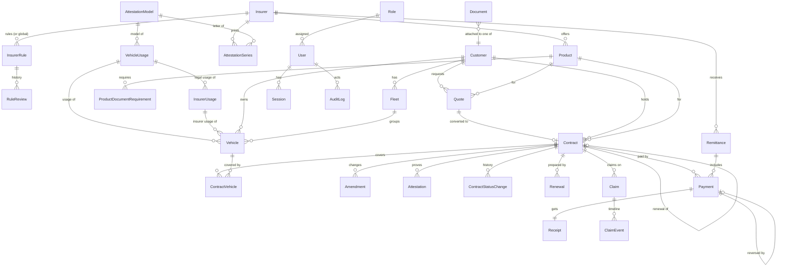

# Data model

Phase 2 design, approved by the owner (PR #3). The Prisma schema (Phase 4 onwards) follows this document;
changes to one must be reflected in the other.

## 1. Entities

### Reference and configuration

| Entity | Key fields | Notes |
|---|---|---|
| `Insurer` | code (`RMA`, `CAT`), name, active, version | **Built (Phase 5).** Data, not hardcoded; seeded RMA and CAT. A third active insurer is refused unless explicitly confirmed (rule L1) |
| `AttestationModel` | code (one letter, unique, fixed by a trigger), label (unique), provisional, officialNumber (unique, arrêté 213-05) and colour, source, status + confirmation fields, active, version | **Built (`feature/attestation-models`).** National models shared by every insurer (agency answers, 22/10/2026): A Tourisme, B Transport public de voyageurs, C Transport de marchandises, D Divers, E deux ou trois roues, F Assurance aux frontières, G Garagistes, P Provisoire — all `TO_CONFIRM` |
| `VehicleUsage` | label (unique), modelCode (→ model, never the provisional one; required to confirm), source, status, confirmedAt + confirmedById + confirmationRef, active, version | **Built (Phase 5).** Usage printed on the attestation (L16). Seeded from the agency's blank forms: Tourisme (14 A), Transport de marchandises (14 C), Véhicules à deux ou trois roues (14 E, 91 E), all `TO_CONFIRM`. A vehicle may only choose a confirmed, active usage |
| `VehicleUsage` « Transport public de voyageurs » | model B, migration 20261031150000 (reference data, « à confirmer ») | Printed on CAT's blank 91 B form (owner, 29/10/2026); needed to record a coach read from a CAT sheet. The setup command does not confirm it: a manager does, like « Divers » |
| `InsurerUsage` | insurerId, groupLabel, label (unique per insurer), usageId (→ legal usage), sortOrder, active | **Built (`feature/rma-usages`).** The insurer's own « Type d'usage » list (RMA GAMA, owner's photos of 28/10/2026, complete per the owner on 29/10/2026): 42 rows — LOCATION and DIVERS under Divers (D, arrêté du ministre des finances art. 58 9°), CYCLOMOTER under Véhicules à deux ou trois roues (E), TOURISME under Tourisme (A), C1 and C2 under Transport de marchandises (C). GARAGISTE left out until garages are handled. Reference data: written by migrations only (`app_runtime` has SELECT only) |
| `AttestationSeries` | insurerId, code (`14 A`, unique per insurer), modelCode (chosen in the catalogue; the code's letter by default; configuration since `feature/catalogue-config`), source, status + confirmation fields, active, version | **Built (Phase 5, models added in `feature/attestation-models`).** Seeded RMA 14 P/A/C/E and CAT 91 P/E from the forms, and the 10 others (RMA 14 B/D/F/G, CAT 91 A/B/C/D/F/G) from the agency's rule "14 = RMA, 91 = CAT" (owner, 23/10/2026; migration `20261024150000_all_series`). Numbers stay editable. Confirmed only after its model. Basis for attestation stock tracking (contracts phase) |
| `Product` | insurerId, line (`CAR`, `MOTORCYCLE`, `TAXI`, `PASSENGER_TRANSPORT`, `COMMERCIAL`, `TRIPORTEUR`, `FLEET`, `BORDER`, `DRIVING_SCHOOL`), name (unique per insurer), insurerCode, description, source, status + confirmation fields, active, version | **Built (Phase 5).** Seeded since `feature/agency-products` (migration `20261024160000_agency_products`): the 17 products the agency sells (owner, 23/10/2026: tourisme, petit and grand taxi, utilitaires, camions et poids lourds, flottes, provisoire, motos, scooters, autres deux-roues, trois-roues et triporteurs, transport de marchandises, de voyageurs, touristique, du personnel, scolaire, autocars et autobus), for RMA and for CAT; the line is the app's grouping. Passenger transport is sold with CAT only (owner, 28/10/2026, migration `20261028120000_passenger_transport_cat`): the 5 RMA products of that line are kept inactive; so are the RMA petit taxi, grand taxi and three-wheeler products, also sold with CAT only (owner, 29/10/2026, migration `20261029200000_taxi_triporteur_cat`), never deleted. The agency may add, rename or deactivate products. `usable` = active **and** `CONFIRMED`; Phase 6 quotes check it again |
| `InsurerRule` | code (`L7`, `C4`…, unique), insurerId (null = all), statement, effect, source, status (`LAW`, `PUBLIC`, `PRESS`, `DOCUMENT`, `UNKNOWN`, `CONFIRMED`), reviewedAt + reviewedById, version | **Built (Phase 5).** Seeded with the 57 rows of `insurer-rules.md` (French text; 45 in Phase 5, 12 added from the official texts in `feature/attestation-models`). Enforced only if `LAW` or `CONFIRMED` (F12). A confirmed rule's text is locked |
| `RuleReview` | ruleId, fromStatus, toStatus, note, reference (required for `CONFIRMED`), reviewerId, at | **Built (Phase 5).** Append-only (INSERT + SELECT for the app role, trigger refuses UPDATE/DELETE) |
| `ProductDocumentRequirement` | productId, stage (`SUBSCRIPTION`, `RENEWAL`, `AMENDMENT`, `CLAIM`), documentType, required, ruleId | Drives checklists. Not built yet: waits for the agency's document lists (insurer-rules.md §D) |
| `Setting` | key, value (json), updatedById | Agency details, reminder periods, deadlines (L5, L7, L8), limits |
| `Counter` | type, year (0 = never restarts), value | **Built (Phase 5).** Incremented with `INSERT … ON CONFLICT DO UPDATE … RETURNING` inside the transaction that uses the number: row-locked, no gaps on rollback |

### People and access (built in Phase 4a, tables `app_user`, `role`, `role_permission`, `session`, `audit_log`)

| Entity | Key fields | Notes |
|---|---|---|
| `User` | username (unique, lower-case, `^[a-z0-9._-]{3,64}$`), displayName, passwordHash (Argon2id), roleId, active, mustChangePassword, failedLogins, lastFailedLoginAt, lockedUntil, totpSecret (encrypted), totpEnabledAt, totpLastStep, passwordChangedAt, lastLoginAt, version | No email needed for login (works offline). Never deleted by the app |
| `Role`, `RolePermission` | code (`ADMIN`, `MANAGER`, `AGENT`, `AUDITOR`), name, requiresTwoFactor; permission codes | Permission codes are fixed in code (`permissions.js`); roles and grants are seeded by migrations and read-only for the app |
| `Session` | tokenHash (unique), userId, stage (`TOTP_VERIFY`, `PASSWORD_CHANGE`, `TOTP_ENROLL`, `ACTIVE`), pendingTotpSecret (encrypted), createdAt, lastSeenAt, expiresAt, reauthAt, revokedAt, revokedReason, ip, userAgent | Server-side, revocable; ended sessions are kept (revokedAt) for the audit trail |
| `AuditLog` | id (bigint), at, actorUserId, action, entityType, entityId, requestId, ip, details (json, no secrets) | **Append-only** |

### Business records

| Entity | Key fields | Notes |
|---|---|---|
| `Customer` | ref (`CLI-000123`), type (`INDIVIDUAL`/`BUSINESS`), firstName, lastName / legalName, ice (business, 15 digits), identityType (`CIN`/`PASSPORT`/`RESIDENCE_CARD`) + identityNumber (optional), phone (E.164), email, addressLine, city, searchText (normalised, for search), assignedUserId, createdById, archivedAt + archivedById + archiveReason, version | **Built (Phase 5).** Same identity number or ICE: refused (unique indexes). Same phone or same name: warning the user may override (audited). Never merged, never deleted (archive) |
| `Vehicle` | ownerId, fleetId?, registration (as written) + registrationKey (letters and digits only, unique), category (`CAR`, `MOTORCYCLE`, `TAXI`, `PASSENGER_TRANSPORT`, `COMMERCIAL`, `TRIPORTEUR`), make, model? (optional, never blank: the RMA platform prints the make alone, owner 29/10/2026), firstRegistrationDate, vin (unique), fiscalPowerCv, engineCc, seats, fuel, taxiType, passengerTransportKind, archivedAt + archivedById + archiveReason, version | **Built (Phase 5).** Only legal requirements enforced (L14): seats for taxis and passenger transport, CV or cylindrée for motorcycles (check `vehicle_category_required`, migration 20261029010000). `(fleetId, ownerId)` references `fleet(id, customerId)`: a vehicle can only join its owner's fleet. `usageId` (rule L16) references a confirmed usage of the catalogue; `insurerUsageId?` is the usage chosen on the insurer's platform, which sets `usageId`. Owner transfer with history: later, with contracts |
| `Fleet` | customerId, name (unique per customer), createdById, version | **Built (Phase 5).** Minimum size is a product rule (C4), shown not enforced |
| `Quote`, `QuoteVehicle` | — | **Dropped** (owner, 23/10/2026): quotes are made on the insurers' platforms |
| `Contract` | ref, customerId, productId + insurerId (composite key to the product), policyNumber?, insurerReference?, startDate, endDate, premiumTotal?, tacitRenewal, noticeDays?, status, version | **Built (`feature/contracts`).** `policyNumber` unique per insurer; issued/suspended need policy number and proof (CHECK). `quoteId` and `previousContractId` arrive with quotes and renewals |
| `ContractVehicle` | contractId, vehicleId, addedAt + addedById, removedAt? + removedById? | **Built.** One active row per vehicle and contract (partial unique index); removal keeps the row. Dated fleet movements on issued contracts come with amendments (F6) |
| `Amendment` | contractId, kind (`VEHICLE_CHANGE`, `REGISTRATION_CHANGE`), number? (the insurer's, unique per contract), effectiveDate, amount? (the avenant's total à payer), insurerReference?, previousVehicleId? (null when the replaced vehicle was never recorded), vehicleId, previousRegistration? + registration? (registration change), attestationId (its new attestation), createdById, createdAt | **Built (`feature/contract-amendments`, migration `20261028184952_contract_amendments`).** Avenant (L28), owner 28/10/2026. Issued contracts only; append-only (trigger). CHECK: a registration change keeps the vehicle and has both plates; a vehicle change changes it. The vehicle replaced leaves the contract (`removedAt`) and is archived unless another running contract covers it; the vehicle's running attestations get `replacedById`. `Contract.amendmentsTotal` adds each amount in the same transaction: what is owed is `premiumTotal + amendmentsTotal` (null only when both are unknown) |
| `Attestation` | contractId, vehicleId, seriesId, number (digits), provisional, validFrom, validTo, medium (`PAPER`/`ELECTRONIC`), coverNoteRef?, duplicateOfId?, cancelledAt + by + reason, replacedById? (the avenant that replaced it) + returnedAt? + returnedById? (its paper back at the agency, CHECK: only when replaced), version | **Built.** Recorded, never generated (F4, L15, L27). Number unique per series except duplicates (L26); provisional at most one month, exactly one month allowed (CHECK, L23, migration 20261030120000). The scan (`documentId`) arrives with documents (Phase 8) |
| `ContractStatusChange` | contractId, from, to, reason?, insurerReference?, effectiveDate?, userId, at | **Built.** Every transition; append-only (privileges + trigger); a cancellation always has a reason (CHECK) |
| `AttestationBatch` | seriesId, firstNumber, lastNumber, quantity, receivedOn, insurerReference?, location, holderId, receivedById | **Built (`feature/attestation-stock`).** CHECK: digits, same length, quantity = last − first + 1, at most 5 000 |
| `AttestationForm` | batchId, seriesId, number (unique per series), status (`AVAILABLE`, `ASSIGNED`, `USED`, `RETURNED`, `DAMAGED`, `LOST`, `CANCELLED`), holderId?, attestationId? (unique), version | **Built.** One row per printed form. CHECK: used / cancelled ⇔ attestation; in stock / assigned ⇒ holder |
| `AttestationFormMovement` | formId, fromStatus?, toStatus, fromHolderId?, toHolderId?, reason?, attestationId?, userId, at | **Built.** Append-only (privileges + trigger); returned / damaged / lost need a reason (CHECK) |
| `Renewal` | contractId (unique), dueDate, status (`TO_PREPARE`, `CUSTOMER_CONTACTED`, `DOCUMENTS_COMPLETE`, `RENEWED`, `NOT_RENEWED`), assignedUserId, renewedContractId?, outcomeReason?, version | **Built (`feature/renewals`).** Opened 30 days before the end of an issued contract, for its creator. CHECK: renewed ⇔ new contract; not renewed ⇒ reason. `Contract.previousContractId` (unique) links the renewal chain |
| `RenewalEvent` | renewalId, fromStatus?, toStatus?, fromAssigneeId?, toAssigneeId?, note?, userId? (null = automatic opening), at | **Built.** Append-only (privileges + trigger) |
| `Contract.guarantees` | JSONB list `[{ label, details?, premium? }]` (CHECK: an array or null), migration 20261030180000 | The guarantees printed on the insurer's platform sheet, kept as read when the contract is created or renewed from it (not from an avenant's sheet, never on a contract already followed); shown read-only on the contract page; never a price of the app |
| `Contract.formula` | VARCHAR(40), null or not blank (CHECK), migration 20261031120000 | The formula printed after the optional guarantees (« RC », « BOOST RC », « RC POIDS LOURDS », « DC »; owner, 29/10/2026: RC = responsabilité civile, DC = dommages collision), kept with the guarantees, taken off each guarantee's details; shown once on the contract page with its meaning, and as the column « Formule » of the report of contracts ending |
| `Payment` | receiptNumber (unique, `REC-YYYY-NNNNN`), contractId, kind (`PAYMENT`/`REVERSAL`), amount (positive / negative), method (`CASH`, `CHEQUE`, `TRANSFER`, `CARD`, `OTHER`), reference?, payerName?, clientPaid? (cash really given when the agency rounded; cash payments only, never equal to the amount), cashTendered? (cash the customer handed over, when typed: the receipt prints it and the change, computed as cashTendered − (clientPaid or amount); cash payments only, never less than what the customer paid; owner, 30/10/2026), receivedAt, receivedById, reversesId? (unique, same contract), reason?, idempotencyKey (unique) | **Built (`feature/payments`).** Never updated or deleted (privileges + trigger); a reversal cancels the exact amount (trigger); balance = premium − sum, calculated |
| `Receipt` | — | **Merged into `Payment`**: each payment and each reversal carries its own receipt number |
| `Remittance` | number (unique, `VER-YYYY-NNNNN`), insurerId, collectedUntil (agency day), amount (> 0, sum of its items), method (`TRANSFER`, `CHEQUE`, `PLATFORM`, `CASH`, `OTHER`), reference (required except cash), remittedOn, note?, recordedAt, recordedById, cancelledAt? + cancelledById? + cancelReason? (all or none), idempotencyKey (unique) | **Built (`feature/remittances`).** Premiums paid on to the insurer (F8, L5). Never edited or deleted; only cancelled, once (trigger + column privileges) |
| `RemittanceItem` | remittanceId, paymentId, amount (copy of the payment's, trigger), released | **Built.** A payment is in at most one remittance that is not cancelled (partial unique index); only payments of the remittance's insurer (trigger); cancelling releases the items, never deletes them |
| `Claim` | ref, customerId, contractId, vehicleId?, incidentDate, reportedToAgencyAt, notifiedToInsurerAt?, insurerClaimRef?, type, description, insurerService?, status, assignedUserId, version | Sensitive; restricted access |
| `ClaimEvent` | claimId, at, userId, type, note | Timeline |
| `AttestationScan` | storageKey, sha256, originalName, mimeType, size, uploadedAt + By, text (≤ 20 000), confidence, proposed (JSON), status (`PENDING`, `FILED`, `DISCARDED`), customerId? vehicleId? contractId? (progress of the filing), documentId? (unique), closedAt + By, discardReason, version | **Built (`feature/attestation-scan`).** One pending scan per file (partial unique index); a closed scan never changes and no scan is deleted (trigger, column privileges); CHECK ties each status to its fields |
| `Contract.policyNumber` | unique per insurer **except along one renewal chain** (`previousContractId`) | Since `feature/scan-renewals` (owner, 24/10/2026: renewals printed by the platform; whether RMA keeps the number is not confirmed, so both are allowed). The plain unique index is replaced by the trigger `contract_policy_unique` (advisory lock per number, `contract_policy_taken`, `contract_chain_root`); the API uses the same function |
| `DocumentCapture` | documentId (unique), fields (JSON object, ≤ 8 KB, keys per document type, checked by the API), capturedAt, capturedById, version | **Built (`feature/document-capture`).** What the employee typed from the document; created and corrected, never deleted (privileges) |
| `Document` | contractId, type (`ATTESTATION`, `CONDITIONS_PARTICULIERES`, `QUITTANCE`, `NOTE_DE_COUVERTURE`), originalName, mimeType (PDF, JPEG, PNG), size (≤ 10 MB), sha256, storageKey (unique, `YYYY/MM/<uuid>`), uploadedAt, uploadedById, replacesId? (unique; same contract and type, trigger), removedAt? + removedById? + removeReason? (all or none) | **Built (`feature/documents`) for contracts only**; other owners (customer, vehicle, claim) when a step needs them. Never edited or deleted, only removed once (trigger + column privileges); one file per contract unless removed (partial unique index on contractId + sha256) |
| `BackupRun` | startedAt, finishedAt, status, sizeBytes, sha256, restoreTestedAt? | Shown on the health page |

## 2. Database constraints (enforced by PostgreSQL, not only by code)

- Foreign keys on every relation; `ON DELETE RESTRICT` by default.
- `CHECK (amount > 0)` for `PAYMENT`, `CHECK (amount < 0)` for `REVERSAL`; a reversal must reference a payment of the
  same contract and the opposite amount; **unique** `reversesId` (a payment can be reversed only once).
- Unique: `Receipt.number`, `Payment.idempotencyKey`, `Vehicle.registration`, `(insurerId, policyNumber)`, all `ref` columns.
- `CHECK (endDate > startDate)` on contracts and attestations.
- `Document`: CHECK exactly one owner column is not null.
- Money columns `numeric(14,2)`; no `real` or `double precision` anywhere.
- DB role `app_runtime` has **no DELETE** on `Payment`, `Receipt`, `Remittance`, `Contract`, `ContractStatusChange`,
  `Claim`, `ClaimEvent`, `AuditLog`; and only INSERT + SELECT on `AuditLog`. A trigger also rejects UPDATE/DELETE on `AuditLog`.
- A vehicle's `insurerUsageId` belongs to its `usageId` (trigger `vehicle_insurer_usage_fits`; except an electric vehicle on a usage of model D with an insurer's usage of model E, migration 20261031090000, the fuel now checked too), so the attestation
  model always follows the legal usage.
- Outstanding balance is **calculated** (premium − sum of payments), not stored.

## 3. Status machines

Each table lists every allowed transition. Anything else is rejected with an error and tested.

### 3.1 Quote

| From | To | Condition |
|---|---|---|
| `DRAFT` | `SENT_TO_INSURER` | Required fields complete for the product |
| `SENT_TO_INSURER` | `INSURER_CONFIRMED` | `insurerReference` and `insurerPremium` entered |
| `INSURER_CONFIRMED` | `CONVERTED` | Explicit "create contract" action; creates the contract in `DRAFT` |
| `DRAFT`, `SENT_TO_INSURER`, `INSURER_CONFIRMED` | `CANCELLED` | Reason required |
| `INSURER_CONFIRMED` | `EXPIRED` | `validUntil` passed (daily job) |

### 3.2 Contract

Stored statuses describe what the insurer has done. Time-based labels are **calculated** from dates, not stored.

| From | To | Condition |
|---|---|---|
| `DRAFT` | `AWAITING_INSURER` | Customer, product, dates, vehicles complete |
| `AWAITING_INSURER` | `DRAFT` | Returned for correction |
| `AWAITING_INSURER` | `ISSUED` | `policyNumber` **and** (insurer document uploaded **or** insurer reference entered) |
| `ISSUED` | `SUSPENDED` | Insurer reference + date (rule L9), manager |
| `SUSPENDED` | `ISSUED` | Reinstatement: insurer reference + date, manager |
| `DRAFT`, `AWAITING_INSURER` | `CANCELLED` | Reason |
| `ISSUED`, `SUSPENDED` | `CANCELLED` | Résiliation: insurer reference + date, manager |

Displayed label for `ISSUED`: **À venir** (before start), **Actif**, **Expire bientôt** (within the configured reminder
period), **Expiré** (after end). Renewal creates a **new** contract linked by `previousContractId`; the old one stays as it was.

### 3.3 Payment

Payments are not edited. A payment is `PAYMENT` or `REVERSAL`; reconciliation moves `PENDING` → `CONFIRMED`
(with an external reference) or `PENDING` → `DISPUTED` → `CONFIRMED`. Remittance: `DRAFT` → `SENT` → `CONFIRMED_BY_INSURER`;
a payment in a `SENT` remittance cannot be reversed without a manager note.

### 3.4 Claim

| From | To | Condition |
|---|---|---|
| `OPEN` | `DOCUMENTS_PENDING` | Checklist started |
| `OPEN`, `DOCUMENTS_PENDING` | `NOTIFIED_TO_INSURER` | `notifiedToInsurerAt` entered (deadline warning L7) |
| `NOTIFIED_TO_INSURER` | `IN_PROGRESS` | Insurer claim reference entered |
| `IN_PROGRESS` | `SETTLED_BY_INSURER` / `REFUSED_BY_INSURER` | Insurer decision recorded (the app never decides) |
| `SETTLED_BY_INSURER`, `REFUSED_BY_INSURER` | `CLOSED` | |
| `OPEN`, `DOCUMENTS_PENDING` | `WITHDRAWN` | Customer withdraws, reason |

### 3.5 Renewal

`TO_PREPARE` → `CUSTOMER_CONTACTED` → `DOCUMENTS_COMPLETE` → `RENEWED` (link to the new contract), or from any open
state → `NOT_RENEWED` (reason). Renewals are created automatically for issued contracts within the reminder period,
except border insurance (product line `BORDER`, rule C5): it lasts 6 months at most, has no tacit renewal and is
never renewed (a new insurance at each entry).
