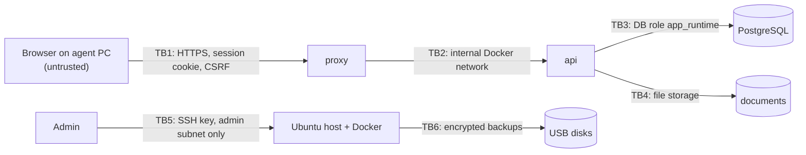

# Security design and threat model

Phase 2 design, approved by the owner (PR #3). This is a living document: every later phase updates the
checklist (§8) with what was actually tested. Nothing here is a claim that the system is secure or legally compliant.

## 1. Assets

| Asset | Why it matters | Sensitivity |
|---|---|---|
| Customer identity data (name, CIN, phone, address) | Personal data under loi 09-08 | High |
| Claim files (injuries, police reports, photos) | May contain health and offence data | **Very high** |
| Uploaded documents (CIN copies, cartes grises, policies, attestations) | Identity theft, fraud | High |
| Payments, receipts, remittances | Money; ACAPS and accounting obligations (L5, L20) | High (integrity) |
| Contracts and statuses | A wrong "active" status can leave a driver uninsured | High (integrity) |
| User accounts and sessions | Access to everything above | High |
| Audit log | Evidence for inspections and incidents | High (integrity) |
| Backups and their encryption key | Contain everything | Very high |
| Server and its admin access (SSH, Docker) | Full control | Critical |

## 2. Attackers and realistic scenarios

| Actor | Scenario |
|---|---|
| Malware on an agent PC | Steals the session cookie or types in the browser as the agent; encrypts shared drives (ransomware) |
| Dishonest or curious employee | Looks at customers they don't handle, exports the customer list, edits or deletes a payment to hide cash |
| Ex-employee | Uses an old password or a still-open session |
| Visitor or device plugged into the LAN | Scans the network, tries the database port, SSH, Docker |
| Thief | Takes the mini-PC or a backup disk |
| Opportunistic Internet attacker | Only if a port is exposed to the Internet by mistake (router port forwarding) |
| Accidents | Disk failure, power cut, wrong `docker compose down -v`, failed migration |

## 3. Trust boundaries

| Boundary | Main controls |
|---|---|
| TB1 Browser → proxy | TLS (local CA), HSTS, strict cookies, CSRF token + Origin check, CSP, rate limits, body size limits |
| TB2 proxy → api | Only the proxy is on both networks; `api` trusts one proxy hop for the client IP |
| TB3 api → db | Separate DB roles: `app_migrator` (schema owner, used only by migrations) and `app_runtime` (data access only, **no DELETE** on financial, contract, claim and audit tables, **INSERT + SELECT only** on the audit log) |
| TB4 api → files | Server-generated names, no user paths, signature checks, authorised streaming only |
| TB5 admin → host | SSH keys only, no root login, allowed from the admin PC address only; Docker socket never mounted into containers |
| TB6 host → backups | Encrypted with **age** to a public key; the private key is kept offline and is not on the server |

## 4. Authentication and authorisation

### 4.1 Authentication

| Control | Setting (default, configurable) |
|---|---|
| Password hashing | Argon2id (library `argon2`), parameters tuned so one hash takes ~0.5 s on the server, at least memory 64 MiB, time 3 |
| Password policy | 12 to 128 characters; refused if in the bundled common-password list (SecLists, 12+ characters, plus local patterns), made of one repeated character, or containing the username; no forced periodic change |
| Session | Random 256-bit token, only its SHA-256 hash stored in `session`; cookie `__Host-session` (HttpOnly, Secure, SameSite=Strict, Path=/, no Domain, no Max-Age) |
| Expiry | Idle 30 minutes, absolute 10 hours (one working day), both configurable; sign-in steps not finished within 10 minutes expire |
| Rotation | New token at login and at every sign-in step (second factor, password change, enrolment); a password change ends every other session of the user; a disabled user is cut off at the next request |
| Brute force | Per address: 20 login attempts per 15 minutes (in memory). Per account (in the database): from the 3rd consecutive failure a delay of 1 s, 2 s, 4 s … up to 60 s before the next attempt; from the 10th, a 15-minute lock after each further failure. Wrong second-factor codes count as failures. Every failure and lock is audited |
| Second factor | TOTP (RFC 6238, 6 digits, 30 s, ±1 step), required for administrator and manager, optional for others. Secrets encrypted with AES-256-GCM (`TOTP_ENCRYPTION_KEY`); a code cannot be used twice. An enrolled factor is checked **before** a forced password change |
| CSRF | `X-CSRF-Token` header on every non-GET request, derived from the session token (SHA-256), plus a strict `Origin` check (login: `Origin` check only) |
| Re-authentication | Password (and code if enrolled) asked again, valid 5 minutes, for: user and role changes, settings, exports of personal data, payment reversals, restore. Guard `requireRecentAuth` |
| First administrator | `npm run create-admin -w backend` on the server: interactive, hidden password, refuses if an active administrator exists, never a default account |
| No public sign-up | Accounts are created by an administrator only |
| Recovery | An administrator resets a user's password (user must change it at next login), Phase 4b. If no administrator can sign in: `npm run create-admin -w backend -- --recovery` on the server, audited |
| Unknown usernames | Answer and timing are the same as a wrong password (a dummy Argon2 check runs) |

Key handling: `TOTP_ENCRYPTION_KEY` lives only in the server's env file (never in git or the database). It must be
kept with the backup recovery material (Phase 12): restoring a database without it forces every user to enrol the
second factor again. Known limit: the per-address login counter is in memory and resets when the API restarts; the
per-account delays and locks are in the database and survive restarts.
### 4.2 Roles and permissions

Permissions are fixed in code (`customers.read`, `payments.create`, …) and grouped into roles stored in the database.
The table below was approved by the owner on 22/10/2026.

| Area | Administrator | Manager | Agent | Auditor |
|---|---|---|---|---|
| Customers, vehicles, fleets: read | ✔ | ✔ | ✔ all records | ✔ |
| Customers, vehicles: create / edit | ✔ | ✔ | ✔ | — |
| Catalogue and rules register: read | ✔ | ✔ | ✔ | ✔ |
| Catalogue: add, edit, confirm; rules: add, edit, review | ✔ | ✔ | — | — |
| Full CIN and identity documents | ✔ | ✔ | ✔ only for records assigned to them or that they open with a stated reason | masked |
| Quotes, contracts: create / edit drafts | ✔ | ✔ | ✔ | — |
| Contract status: issued / cancelled / suspended | ✔ | ✔ | ✔ issued (with insurer reference); cancel / suspend: manager only | — |
| Blank attestation stock: read | ✔ | ✔ | ✔ | ✔ |
| Blank attestation stock: receive, assign, return, declare damaged or lost | ✔ | ✔ | — | — |
| Renewals: read, follow, prepare the new contract | ✔ | ✔ | ✔ | read |
| Renewals: give to another employee | ✔ | ✔ | — | — |
| Payments: record | ✔ | ✔ | ✔ | — |
| Payments: reverse | ✔ | ✔ | — | — |
| Remittances to insurers | ✔ | ✔ | — | read |
| Claims: read and edit | ✔ | ✔ | ✔ assigned claims only | read (sensitive fields masked) |
| Documents: see the list, upload, open | ✔ | ✔ | ✔ | list only |
| Documents: remove (with a reason) | ✔ | ✔ | — | — |
| Documents: type what they print (capture) | ✔ | ✔ | ✔ | — |
| Correct an issued contract (policy number, dates, premium) from a captured document | ✔ | ✔ | ✔ | — |
| Scan an attestation and file it (creates customer, vehicle, contract) | ✔ | ✔ | ✔ | — |
| Reports: see on screen | ✔ | ✔ | — | ✔ |
| Reports: export CSV / Excel (re-authentication, audited) | ✔ | ✔ | — | — |
| État de production: see and print (`production.read`; everyone's or one employee's: `production.all`) | ✔ | ✔ | ✔ own contracts only (the API sets the employee; another one is refused and audited) | ✔ |
| État de production: Excel file (`reports.export`, re-authentication, audited) | ✔ | ✔ | — | — |
| Reports | ✔ | ✔ | own activity and renewals only | ✔ |
| Exports with personal data | ✔ | ✔ | — | — |
| Products, insurer rules register | ✔ | edit | read | read |
| Users and roles | ✔ | — | — | — |
| Settings, backups, system health | ✔ | health only | — | — |
| Audit log | ✔ | ✔ (no edits) | — | ✔ (no edits) |

Rule for every request: **deny unless** the user's role has the permission **and** the service confirms the user may
access that specific record. IDs from the browser are never trusted on their own.

## 5. Threats and mitigations

| # | Threat | Mitigation | Residual risk |
|---|---|---|---|
| T1 | Stolen password | Argon2id, lockout, individual accounts, session revocation, audit of logins, TOTP 2FA for admin and manager | Agent passwords reused elsewhere (2FA optional for agents) |
| T2 | Stolen session cookie (malware on PC) | HttpOnly, short idle expiry, revocation, re-auth for sensitive actions | Malware acting live in the browser can do what the agent can |
| T3 | IDOR (changing an id in the URL) | Record-level checks in every service; integration tests per resource with a second user | Depends on test coverage (Phase 10 review) |
| T4 | Mass assignment (sending `status` or `role` in a body) | Strict Zod schemas; status only via transition endpoints | Low |
| T5 | SQL injection | Prisma; raw SQL only with tagged parameters (`$queryRaw`), lint rule bans `$queryRawUnsafe` | Low |
| T6 | XSS | React escaping, no `dangerouslySetInnerHTML`, strict CSP (`script-src 'self'`), documents served sandboxed | Low |
| T7 | CSRF | SameSite=Strict, CSRF token, Origin check | Low |
| T8e | Customer data shown by a Windows notification on a shared or locked screen | Alerts carry counts only ("3 assurances finissent…"), never a name, plate or number | — |
| T8d | A file stops the server through the image reader | Found 24/10/2026: tesseract.js throws outside the request when it cannot decode an image, which stopped the API. Now: only pictures with a valid size are read, the worker has an error handler, a failed reading is answered "not read" (tested with a broken JPEG; proven by removing the handler) | — |
| T8c | A crafted PDF attacks the reader | pdf.js runs with `isEvalSupported: false` (the known script-execution flaw of older versions), no font loading, no network, text of the first page only; 10 MB limit and signature check before; one version pinned | A new pdf.js flaw: keep the version updated with `npm audit` |
| T8b | Scans read outside the agency | Reading is offline (owner's choice, 24/10/2026): engine and French data are npm packages pinned and installed with the app; nothing is downloaded; the install script of tesseract.js (a sponsorship message) is refused. The text read is personal data: stored with the scan, never written to the audit (only which fields were found) | — |
| T8 | Malicious upload | Built: allow list by file signature (PDF, JPEG, PNG; the announced type must match the first bytes), 10 MB limit before reading further, random names under `DOCUMENTS_DIR` (outside the web root), never executed, served with its stored type, `nosniff` and `default-src 'none'`; every opening audited. Not yet: ClamAV | A crafted PDF may still exploit a PDF reader on the agent PC: keep the browsers up to date |
| T9 | Insider edits or deletes payments | No update/delete on payments at the DB-role level, reversals only (manager), audit in the same transaction, daily totals report | A manager acting alone; mitigated by audit review |
| T9b | Insider hides a remittance or remits a payment twice | Remittances and their items are INSERT-only for the app except the cancellation columns; triggers refuse any other change, deletion and un-cancelling even for the owner; a payment is in one active remittance at most (partial unique index), of its own insurer (trigger); cancellation by management with a reason, audited | A manager acting alone; mitigated by audit review |
| T10 | Mass export of customers | Export permission, re-auth, audit event with row count, only needed columns | An authorised manager can still export |
| T11 | Database reached from the LAN | No published DB port; internal Docker network; firewall | Low |
| T12 | Docker bypasses the firewall | Publish 443 only on the server's LAN address; restrict source subnet in the `DOCKER-USER` chain ([network.md](network.md) §4) | Misconfiguration; tested in Phase 11 |
| T13 | Server stolen | Full-disk encryption (LUKS bound to TPM 2.0 + recovery key kept offline) | With TPM unlock, a thief who takes the whole machine can boot it; they still need an app or SSH login |
| T14 | Backup disk stolen | Backups encrypted with age; private key not stored with the disks | Key loss = backups unusable; recovery key procedure in Phase 12 |
| T15 | Ransomware | Server not used for browsing or file sharing; backups encrypted and **disconnected** when not in use; rotation of two disks. **Built (Phase 12):** encrypted with `age` for a public key, the private key never on the server; one disk always at the owner's home; the restore drill (`deployment/rehearsal/run-drill.ps1`) erases everything and restores | Data since the last offline copy (the disk at home: up to a week) |
| T16 | Hardware failure / power cut | UPS, PostgreSQL crash safety, tested restore | Data since the last backup (RPO to agree) |
| T17 | Destructive admin command (`docker compose down -v`, bad migration) | Named volumes marked external, migrations reviewed and tested on a copy, backup before every update | Human error |
| T18 | Sensitive data in logs | Redaction list, no request bodies logged, tests that check log output | Low |
| T19 | Vulnerable dependencies or images | Exact pins, `npm audit` and Trivy scans each step, documented update procedure | Zero-day vulnerabilities |
| T20 | Fake "official" documents produced by the app | No templates imitating insurers; internal PDFs carry a "document interne" footer (rules L2, L3); the receipt carries the agency's own logo and legal line, never an insurer's logo (owner, 30/10/2026) | Low |
| T21 | A planted file shown as the agency's logo (script in an "image") | Logo and icon read once at startup from paths in the settings, accepted only as PNG or JPEG by their first bytes and up to 1 MB, sent with their real type and `nosniff`; SVG never accepted; the public brand route gives the name and tagline only | Someone able to change the server's settings |
| T22 | The workspace cards taken for a separation of the insurers' data | Owner 04/11/2026: every user may see every insurer; the card chosen after sign-in only filters the lists on screen (`insurerId`), clients and vehicles included (those with a contract there, or none; a client's page still shows all their contracts), each API still checks its permission, and typing another address or another insurer's id shows what the user could already see. Real per-insurer access (a user limited to RMA or CAT, refused by the server) would need a database change and is not built | A user may forget the filter: each filtered list says « Espace RMA : seuls les dossiers RMA sont affichés ici » with « Voir les deux » |
| T23 | A planted file shown as an insurer's logo or photo, or a path to another file of the server | Same checks as T21 for each image; the JSON names files of its own folder only (letters, digits, `._-`, `.png`/`.jpg`), checked at startup; images sent behind sign-in with their real type and `nosniff`; colours accepted only as `#RRGGBB`. Insurer logos only on screen, never on a printed document (rules L2, L3), and only with the insurer's permission | Someone able to change the server's settings |

## 6. Data protection by design

- Collect only what a workflow needs; CIN is optional unless a confirmed product rule requires it.
- CIN shown masked by default (`AB****56`); full value only for permitted roles; viewing a document is audited.
- Field-level encryption: **not planned at first**. Disk encryption and encrypted backups cover theft; field encryption
  would break duplicate detection and search. Re-assess if the legal review (requirements §5) asks for it.
- No real customer data in development, tests, screenshots or git. Seed script makes clearly fake demo data.
- Retention, access and correction procedures wait for the legal answers in [requirements.md](requirements.md) §5.

## 7. Owner decisions

| Decision | Outcome |
|---|---|
| Second factor (2FA) at login | **Yes** (22/10/2026): TOTP (authenticator app, works offline), required for administrator and manager accounts, optional for agents. Built in Phase 4 |
| Permission matrix §4.2 | **Approved** as proposed (22/10/2026) |
| Who keeps the backup decryption key and the disk recovery key | **Open**: decided in Phase 12 (two people, sealed envelope, safe) |

## 8. Security checklist (updated each phase)

| Control | Phase | Status |
|---|---|---|
| Threat model written | 2 | Approved (PR #3) |
| Secrets only in git-ignored env files, validated at startup | 3 | Done: Zod validation, errors name variables only (unit tests); `.env` files git-ignored |
| Security headers, CORS, body limits | 3 | Done: helmet (CSP `default-src 'none'` on the API), no CORS headers, JSON limit 100 kB, `Cache-Control: no-store` (unit tests) |
| Logs without personal data | 3 | Done: path-only request lines, redaction list (unit test, proven by breaking it) |
| Safe error responses | 3 | Done: generic messages + request id (unit test, proven by breaking it) |
| No external resources in the interface | 3 | Done: e2e blocks and records any non-local request (proven by adding a CDN font) |
| Dev database only on loopback | 3 | Done: `127.0.0.1:55433` |
| Argon2id, sessions, CSRF, lockout, 2FA for admin/manager | 4a | Done: integration tests on real PostgreSQL (CSRF, permission and replay checks proven by breaking them) |
| Deny-by-default authorisation + IDOR tests | 4–7 | 4a: guards `requireStage` / `authorize` / `requireRecentAuth`, denied access audited. 4b: user administration refused to agents, managers and auditors; unknown and malformed ids tested; IDOR tests continue with business records (Phase 5) |
| DB roles without DELETE on protected tables | 4 | 4a: `app_runtime` has no DELETE on users, no writes on roles, INSERT+SELECT only on `audit_log` (tested); SELECT only on `insurer_usage`, reference data written by migrations (tested) |
| Audit log append-only | 4 | 4a: privileges + trigger rejecting UPDATE/DELETE even for the owner (tested). 4b: read-only viewer for administrator, manager, auditor; no write route (tested) |
| Sensitive administration behind re-authentication, optimistic versions, last-admin protection | 4b | Done (integration tests, each proven by breaking it) |
| Internal security review after Phase 4 | 4 | Done 22/10/2026: 6 findings (2 medium, 4 low), all fixed and tested — see §9 |
| Vehicles and fleets: permissions, no DELETE, database constraints | 5 | Done: category rules and fleet ownership enforced by the API **and** by CHECK constraints and a composite foreign key (the database still refused a foreign fleet when the API check was removed) |
| Overload never answered with an internal error | 6 | Done: database transaction limits sized for a busy office server (10 s to start, 15 s to finish), and at most 10 s to get a free connection of the pool (pg waited forever by default: a request could hang instead of failing); if still exceeded, 503 "server busy" (nothing was saved), details logged (tested) |
| Money received: never altered, never more than the premium | 7 | Done: payments are INSERT-only for the app and a trigger refuses UPDATE / DELETE even for the owner (tested); a reversal is a new row with the exact opposite amount (trigger) and a reason (CHECK); reversal for administrator and manager only (tested); total never above the insurer premium, with the contract row locked against simultaneous payments (tested 3/3 without the lock, 3/3 with it); one payment per request (idempotency key); gapless receipt numbers never reused |
| Renewals: every outcome explained | 6 | Done: "not renewed" needs a reason (API and CHECK); a renewed renewal names its new contract (CHECK); closed renewals do not change; reassignment for administrator and manager only (tested); follow-up history append-only (privileges + trigger, tested); no DELETE |
| Blank attestations: every form accounted for | 6 | Done: one row per serial number, no overlap; movements append-only (privileges + trigger, tested) with who, when, from / to and why; exceptions need a reason (API and CHECK); a used form names its attestation (CHECK); an assigned form is used only by its holder unless a manager records it; no DELETE (tested) |
| Contracts: statuses reflect insurer decisions only | 6 | Done: issue needs the insurer's policy number and proof (API and CHECK constraint); suspension, reinstatement and termination of an issued contract need `contracts.terminate` (administrator, manager), refusals audited (tested); every cancellation has a reason (API and CHECK); status history append-only (privileges + trigger, tested); no DELETE on contracts, covered vehicles, attestations (tested); attestation numbers entered, never generated; avenants (`feature/contract-amendments`) on issued contracts only, append-only (privileges + trigger, tested), each one's fields held by a CHECK (vehicle change changes the vehicle, registration change keeps it with both plates, tested), a returned paper only for a replaced attestation (CHECK, tested), the whole avenant in one transaction (a refused attestation leaves nothing behind, tested) |
| Catalogue and rules register: nothing usable without a recorded confirmation | 5 | Done: `catalogue.manage` for administrator and manager only (agent and auditor refused, tested); confirmations store who, when and which document, and a CHECK constraint refuses a confirmed row without them; a confirmed rule needs a document reference, checked by the API **and** a CHECK constraint (each tested separately); review history append-only (privileges + trigger, tested); no DELETE for the app role on catalogue tables (tested); a model's letter cannot change (trigger, tested); which model a series has is configuration (owner, 23/10/2026), and changing it clears the series' confirmation (tested); the reference command confirms only for an active administrator or manager (tested) |
| Customer records: record-level checks, identity minimisation | 5 | Done: identity numbers absent from lists, masked in details unless allowed, reveal with audited reason, no edit of a hidden number, field names (not values) in audit, no DELETE for the app role, CHECK constraints (integration tests, 3 proven by breaking them) |
| Upload validation and authorised download | 8 | Not started |
| Dependency and image scans | every step | Phase 3: `npm audit` 0 vulnerabilities (after moving Prisma 7.10.0 → 7.10.1 for 4 high advisories); image scans from Phase 11 |
| DB not reachable from LAN (tested from another host) | 11 | Not started |
| Firewall and Docker port restriction tested | 11 | Not started |
| Encrypted backup + tested restore | 12 | Not started |
| Offline operation tested | 11, 13 | Not started |

## 9. Security review — 22/10/2026 (after Phase 4)

Scope: all backend and frontend code at the end of Phase 4 (authentication, sessions, CSRF, authorisation, user
administration, audit log, configuration, dependencies), reviewed against OWASP Top 10:2025 and ASVS 5.0. No
dangerous sinks found (`eval`, raw HTML, unsafe SQL, shell strings, `Math.random` for secrets). This is an internal
review by the developer, not a substitute for an independent penetration test before the pilot.

| # | Severity | Finding | Status |
|---|---|---|---|
| R1 | Medium | A signed-in session could enrol a new second factor without the password: someone at an unattended PC could add their own phone and lock the owner out (CWE-306, A07) | Fixed: re-authentication required from a signed-in session (test proven by breaking it) |
| R2 | Medium | In production, `TRUST_PROXY=0` behind the HTTPS proxy would make every office PC share one login limit: 20 attempts per 15 minutes for the whole agency (CWE-1188, A02) | Fixed: the API refuses to start in production with `TRUST_PROXY` below 1 |
| R3 | Low | "Too many attempts" appeared only for existing usernames, revealing which ones exist (CWE-204, A07) | Fixed: unknown usernames are throttled with the same rules (in memory, bounded) |
| R4 | Low | Re-authentication did not issue a new session token (ASVS 7.2.4) | Fixed: new token and CSRF token at re-authentication |
| R5 | Low | Two simultaneous requests could use the same second-factor code (check-then-write race, CWE-367) | Fixed: the code step is consumed by a conditional database update; deterministic test |
| R6 | Low | A password typed by mistake into the username field was stored in the audit log (CWE-532, A09) | Fixed: only values shaped like a username are recorded, otherwise `[format invalide]` |

Accepted or deferred (not vulnerabilities in the current code, tracked):

| Item | Decision |
|---|---|
| An attacker on the LAN can keep an account locked by failing its password on purpose | Accepted trade-off of lockout; locks are audited and an administrator can unlock. Re-assess if abused |
| Server clock: TOTP and audit timestamps need an accurate clock, and the server is offline | Phase 11: time synchronisation (router or NTP when Internet is available), clock check on the health page |
| One application origin only (`APP_ORIGIN`): opening the app by IP and by name would fail the Origin check | Phase 11: choose one address (hostname) or support a list |
| Expired sessions are never deleted from the database | Phase 12 retention: periodic clean-up of sessions older than 90 days |
| Logs stay on the server | Phase 12: copy logs with the encrypted backups |
| Breached-password check limited to a bundled list | Accepted for an offline system (ASVS L2 6.2.12 partially met) |

## 10. Security review — 30/10/2026 (before deployment, Phase 10)

Scope: everything built since the first review: customers, vehicles, catalogue, contracts and avenants, attestation
stock, renewals, payments and receipts (roundings, cash handed over), remittances, documents and their capture, scans
(PDF reading with pdf.js, offline OCR), reports and exports, the home to-do list and search, the agency's brand; reviewed
against OWASP Top 10:2025 and ASVS 5.0. Every route was listed from the application itself: all are behind a permission
check except the seven public ones (health checks, sign-in, `/api/auth/me`, the agency's name, logo and icon). No
dangerous sinks found: SQL only through Prisma or tagged `$queryRaw` templates (parameterised), no raw HTML in the
screens, no `eval`; uploads checked by type and first bytes, stored under server-made names, served with their real type,
`nosniff` and a CSP; exports neutralise cells that Excel would run as formulas; session tokens 256 random bits, stored
hashed, `__Host-` cookie, `SameSite=Strict`; CSRF by Origin and token; every dependency pinned exactly, `npm audit` 0. Again
an internal review by the developer, not an independent penetration test.

| # | Severity | Finding | Status |
|---|---|---|---|
| R7 | Low | A scanned picture is read by the OCR whatever size it declares: a small PNG or JPEG (a file a client e-mailed, uploaded in good faith by an employee) can declare 30 000 × 30 000 pixels and take gigabytes of memory to decode, slowing or stopping the API (CWE-409, A06). Signed-in employees only | Fixed: pictures over 50 million pixels are not read (an A4 page at 600 dpi is about 35 million); the scan is kept and typed, a warning is logged (unit test `ocr.test.js` › image bomb, proven by breaking) |
| R8 | — | Not a finding: no automatic proof that a route added later carries a permission check | Added: `access.test.js` reads every route from the application: before sign-in each one but the public list answers 401; the read-only auditor gets 403 on every change and on what is not theirs (users, scans, files, exports, assignees, system status), each refusal audited (proven by breaking: a guard removed from « annuler un paiement » failed both tests) |
| R10 | Low | Found while writing the restore guide (Phase 12): on a new server, the first `install.sh` run stopped before loading the images, so a restore could not start (the drill had not seen it: the images were still on the laptop) | Fixed: `install.sh` loads the images first; the drill now removes them before restoring, like a new server, and passes |
| R9 | Low | Found in the deployment rehearsal (Phase 11), before any installation: `install.sh` created the folder of the agency's logo readable by root only, so the API (unprivileged user) could not read it and refused to start, saying « file not found » | Fixed: the folder 0755 and its files 0644 (public logo only); the startup check now says « file not readable (permissions) » when that is the cause; the rehearsed update passes |

Accepted or deferred:

| Item | Decision |
|---|---|
| The browser application has no Content-Security-Policy yet (only the API sends one) | **Done (Phase 11):** Caddy sets `default-src 'self'`, `img-src 'self' data:`, `frame-src 'self'`, `object-src 'none'`, `base-uri 'none'`, `frame-ancestors 'none'`, HSTS, `nosniff`, `Referrer-Policy: no-referrer` and a restrictive `Permissions-Policy`; the production smoke test checks them and fails without the CSP |
| Any employee can read and change any customer (no "own customers only") | By design for one small agency (owner's answers); every change is audited with who and when |
| OCR and PDF reading are heavy: many uploads at once slow the server | Accepted: one reading at a time (queue), 10 MB per file, signed-in employees only |
| Trivy scan of container images | **Done 30/10/2026 (Phase 11):** the first images (Debian 12, Caddy 2.10.2) had 57 + 34 + 68 high or critical findings; moved to Debian 13 slim and Caddy 2.11.7 with npm, corepack and curl removed: **0 high or critical with a fix** in the API image and in the proxy's packages. 6 high remain inside the Caddy binary itself (go-jose, x/net, Go stdlib; fixed upstream, no Caddy build yet), none used by this proxy (no ACME, no outgoing requests): update when Caddy publishes. Debian findings without a patch yet are rechecked at each release |

